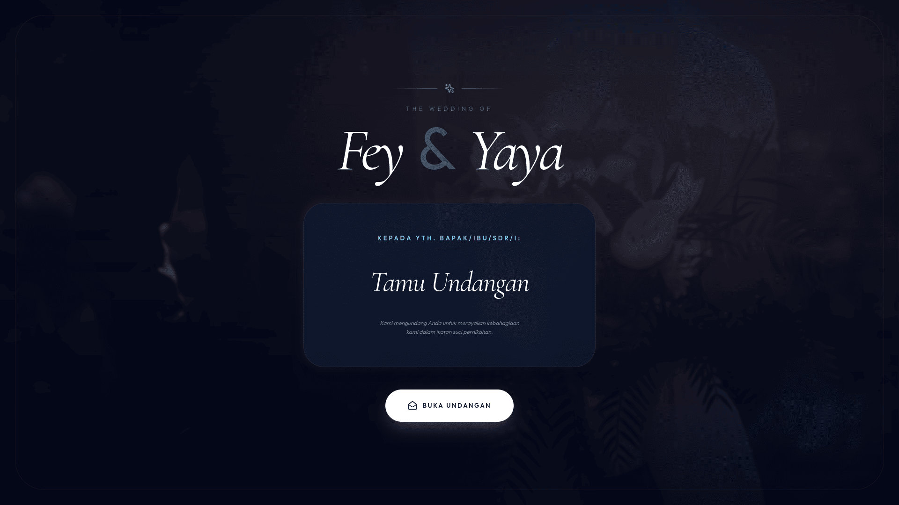

# Website Undangan Pernikahan Digital

Website undangan pernikahan digital modern, cepat, dan interaktif yang dibangun menggunakan **Astro 7 SSR**, **React 19**, **Tailwind CSS v4**, dan **SQLite (`better-sqlite3`)**. Dilengkapi panel admin lengkap untuk mengelola konten undangan secara dinamis, daftar tamu permanen + **Scanner QR Check-In**, generator **QR Code** & **Undangan PDF**, serta integrasi penuh **WhatsApp Gateway (`whatsapp.zedlabs.id`)**.



---

## Fitur Utama

### Halaman Undangan (Tamu)
- **Amplop Digital & Personalisasi Tamu:** Mendukung tautan personal `/?to=Nama+Tamu` (dan `&code=G-XXXX` untuk check-in), dengan tombol *Ubah Nama* bila tautan diteruskan ke orang lain.
- **SSR & SEO / OpenGraph Dinamis:** Judul halaman, deskripsi, dan gambar pratinjau WhatsApp/sosial media dibaca langsung dari SQLite saat server-side rendering (tanpa loading spinner awal).
- **Kontrol Musik Latar:** Tombol Play/Pause mengambang yang menghormati preferensi tamu saat dijeda.
- **Mode Terang & Gelap:** Deteksi preferensi sistem otomatis, tersimpan di `localStorage`, plus dukungan `prefers-reduced-motion`.
- **Hitung Mundur Real-Time:** Kalkulasi instan tanpa jeda 1 detik, otomatis menampilkan status saat hari acara tiba.
- **Profil Mempelai & Kisah Cinta:** Timeline responsif dan tautan Instagram opsional.
- **Detail Acara, Peta & Kalender:** Zona waktu dinamis (`WIB`/`WITA`/`WIT`), integrasi Google Calendar & file `.ics` (Apple/Outlook), salin alamat, dan embed Google Maps.
- **Galeri Foto & Lightbox:** Masonry responsif dengan lightbox fullscreen aksesibel keyboard (`ArrowLeft`, `ArrowRight`, `Escape`).
- **RSVP & Buku Tamu (Ucapan & Doa):** Rate limiting per IP (kompatibel reverse proxy Nginx), validasi input ketat, proteksi overwrite berbasis signed ownership cookie, serta paginasi ucapan.
- **Tanda Kasih (Amplop Digital & Kado Fisik):** Daftar rekening bank dengan tombol salin dan dukungan alamat kirim kado fisik terpisah dari alamat venue.
- **PWA Ready:** Mendukung pemasangan ke layar utama perangkat mobile.

### Admin Dashboard (`/admin` & `/checkin`)
- **Statistik Reaktif:** Total respon, hadir (beserta total pax), ragu, dan tidak hadir langsung diperbarui saat edit/hapus data.
- **Data RSVP & Ucapan:** Tambah manual, edit data (status interaktif & stepper pax), hapus satuan/massal, **Import CSV / Tempel dari Excel** (dengan pratinjau & deteksi kolom otomatis), serta export CSV aman dari CSV Formula Injection.
- **Manajemen Daftar Tamu Permanen & QR Check-In (`/checkin`):**
  - Simpan daftar tamu permanen di SQLite dengan kode check-in unik (`G-XXXXXXXX`), grup, dan kuota pax (lengkap dengan form berlabel, edit tamu, dan stepper kuota).
  - **Import CSV / Tempel dari Excel** (drag & drop, dukung pemisah `,`, `;` Excel ID, dan Tab) & Export CSV daftar tamu, salin link personal, kirim undangan WA langsung, serta check-in manual.
  - **Scanner QR Check-In Hari H:** Memindai QR via kamera (`BarcodeDetector` API) atau input manual dengan saran cepat nama tamu belum check-in, lengkap dengan dukungan tamu *walk-in* 1-klik.
- **Integrasi WhatsApp Gateway (`whatsapp.zedlabs.id` | HMAC-SHA256 v2):**
  - **Notifikasi Otomatis ke Admin/Mempelai:** Pemberitahuan otomatis ke satu atau lebih nomor WA admin saat ada RSVP atau ucapan baru/diperbarui.
  - **Konfirmasi Otomatis ke Tamu:** Balasan WA otomatis berisi ringkasan RSVP & jadwal acara saat tamu mengisi nomor HP.
  - **Kirim Undangan Otomatis (Satuan, Daftar Tamu & Massal CSV/Excel):** Tarik langsung penerima dari Daftar Tamu Permanen (dengan filter grup) atau Import CSV/Excel, opsi lampiran QR Code PNG, riwayat pengiriman, polling status, dan kirim ulang.
  - **Sinkronisasi 4 Template 1-Klik** langsung ke gateway + tombol **Uji Koneksi (Ping)** & **Kirim Pesan Tes**.
- **QR Generator & Design PDF:** Generator QR resolusi seragam `300×300px` dan undangan cetak PDF 4 halaman A5 multi-tema; mendukung pilih cepat atau muat massal 1-klik dari Daftar Tamu maupun Import CSV/Excel.
- **Pengaturan Konten User-Friendly, Upload Audio Backsound & Import/Export CSV:** Date/Time picker otomatis (mengisi hari, tanggal Indonesia, dan ISO sekaligus), ekstrak koordinat otomatis dari link Google Maps, auto-clean username Instagram, preset bank/e-wallet, **upload audio backsound lokal (`MP3`/`M4A`/`OGG`/`WAV`, maks 15 MB, mendukung HTTP Range streaming + pratinjau audio)**, upload banyak foto galeri sekaligus, sticky save bar, serta **Import & Export CSV** untuk pengaturan, rekening bank, dan kisah cinta.

---

## Keamanan
- **Sesi Admin Berbasis Token Server:** Cookie `httpOnly` + `sameSite: "lax"` + `secure` otomatis saat HTTPS; hash token acak 256-bit disimpan di tabel `admin_sessions` (SQLite) dengan kedaluwarsa 24 jam.
- **Verifikasi Password Constant-Time:** Menggunakan `process.env.ADMIN_PASSWORD` + `crypto.timingSafeEqual` (tanpa fallback password default) serta rate limit login (maks 5 percobaan / 15 menit).
- **Proteksi Endpoint Sensitif:** Seluruh endpoint admin, export CSV, upload media, dan WhatsApp mewajibkan sesi admin aktif.
- **Validasi Input & Media:** Whitelist konfigurasi, sanitasi CSV Formula Injection, validasi magic bytes gambar (`JPG`/`PNG`/`WebP`, maks 5 MB), dan penyaringan `/admin`, `/qrcode`, `/checkin`, `/api/` dari sitemap & `robots.txt`.

---

## Stack Teknologi
- **Framework:** Astro 7 (SSR `@astrojs/node` standalone) + React 19 + TypeScript
- **Styling:** Tailwind CSS v4 + Lucide Icons
- **Database:** SQLite (`better-sqlite3`, mode WAL)
- **Integrasi:** WhatsApp Gateway (`whatsapp.zedlabs.id`, HMAC-SHA256 v2)
- **Tools:** `qrcode`, `qrcode.react`, `jspdf`, `jszip`, `papaparse`, `vite-plugin-pwa`
- **Deployment:** PM2 + Nginx Reverse Proxy

---

## Instalasi & Development

### Prasyarat
- Node.js `>= 22` (disarankan **Node.js 24** untuk `node --test` TypeScript native)
- `pnpm`

### Langkah Menjalankan
```bash
# 1. Install dependencies
pnpm install

# 2. Salin konfigurasi environment
cp .env.example .env
```

Edit `.env` dan isi minimal `ADMIN_PASSWORD` serta `SESSION_SECRET`:
```env
HOST=127.0.0.1
PORT=5432
DB_NAME=wedding.db
ADMIN_PASSWORD=isi-password-admin-kuat
SESSION_SECRET=isi-secret-acak-minimal-32-karakter
```

```bash
# 3. Jalankan server development
pnpm dev
```

Akses aplikasi:
- Halaman Undangan: `http://localhost:4321`
- Panel Admin: `http://localhost:4321/admin`
- Scanner Check-In: `http://localhost:4321/checkin`

---

## Scripts

| Perintah | Keterangan |
| :--- | :--- |
| `pnpm dev` | Menjalankan server development Astro |
| `pnpm build` | Build produksi SSR ke folder `dist/` |
| `pnpm preview` | Pratinjau hasil build produksi |
| `pnpm lint` | Menjalankan ESLint di seluruh proyek |
| `pnpm typecheck` | Memeriksa tipe TypeScript (`tsc --noEmit`) |
| `pnpm test` | Menjalankan unit test (`node --test tests/*.test.ts`) |
| `pnpm format` | Memformat kode dengan Prettier |

---

## Panduan Aktivasi WhatsApp Gateway (`whatsapp.zedlabs.id`)

1. Buat API Key pada dashboard `whatsapp.zedlabs.id` dan pastikan minimal 1 sesi WhatsApp berstatus **ready**.
2. Buka `/admin` → tab **Pengaturan** → bagian **Integrasi WhatsApp Gateway**.
3. Isi **URL Gateway**, **API Key (`key_id`)**, **HMAC Secret**, dan **Nomor WA Admin/Mempelai** (bisa lebih dari satu, pisahkan dengan koma).
4. Klik **Simpan Semua**, lalu jalankan secara berurutan:
   1. **Uji Koneksi (Ping)** | memastikan tanda tangan HMAC v2 valid dan sesi WA siap kirim.
   2. **Sinkron 4 Template ke Gateway** | mendaftarkan otomatis template `wedding_undangan_tamu`, `wedding_rsvp_admin`, `wedding_ucapan_admin`, dan `wedding_rsvp_konfirmasi`.
   3. **Kirim Pesan Tes** | memverifikasi pengiriman nyata ke nomor admin.

---

## Deployment Produksi (PM2 + Nginx)

```bash
# Build produksi
pnpm install --frozen-lockfile
pnpm build

# Jalankan dengan PM2 (binding 127.0.0.1:5432)
pm2 start ecosystem.config.cjs
pm2 save
```

Gunakan konfigurasi di [nginx.conf](./nginx.conf) sebagai reverse proxy dan aktifkan SSL/HTTPS (mis. via Certbot) agar cookie sesi `Secure` serta fitur kamera QR Check-In bekerja optimal.

Database SQLite dan file foto hasil upload tersimpan di folder `database/` (`database/wedding.db` dan `database/uploads/`) sehingga aman terhadap rebuild/redeploy.

---

## Roadmap Berikutnya
- **Payment Gateway / Amplop Digital (QRIS & Pembayaran Online):** Direncanakan untuk pengembangan tahap selanjutnya setelah layanan payment gateway tersedia.

---

## Lisensi
[MIT](./LICENSE)
